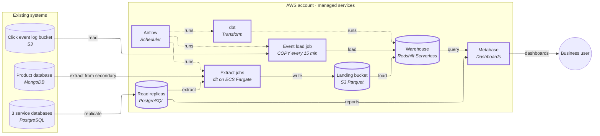
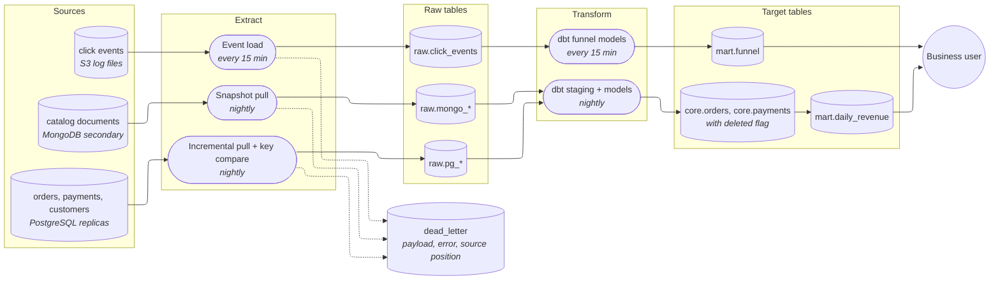

# Data platform design — e-commerce analytics

## Decision

Build a small columnar warehouse (a database built for analytical queries) on AWS, fed by a nightly batch copy of the three PostgreSQL databases and the MongoDB database, plus a 15-minute load of the click events already sitting in the log bucket. Reporting is pointed at read replicas (copies of the production databases that serve only reads) first, so the production slowdown stops within days. A lakehouse (open table files on object storage, queried by several engines) with Spark, Flink and Kafka is deliberately not built: nothing the three consumers need today requires it, and a two-person team would spend its time operating it instead of delivering dashboards.

This rests on three assumptions: managed AWS services are acceptable to pay for, the two engineers have only part of their time for the platform, and "real-time" for the funnel dashboard means data no more than 15 minutes old (see Questions and assumptions).

## Architecture

| Component | What it does | Tool |
|---|---|---|
| Read replicas | Serve reporting reads so production databases are left alone; also the clean source for extraction | PostgreSQL read replicas (one per service database) |
| Extract jobs | Copy new and changed rows nightly, compare keys to catch deletes, write Parquet files | dlt (Python) on ECS Fargate |
| Landing bucket | Keeps every extracted file, so any load can be replayed | S3 |
| Event load job | Loads new click-event files from the log bucket every 15 minutes, drops duplicate events, routes unreadable lines to a dead-letter table | Redshift `COPY` run by Airflow |
| Warehouse | Stores raw, cleaned and business tables | Redshift Serverless |
| Transform | Builds cleaned tables and the revenue and funnel models, with tests | dbt (SQL) |
| Orchestration | Schedules, retries and alerts on every job | Airflow (managed, Amazon MWAA) |
| BI | Dashboards for finance, ops and product | Metabase |

## Pipeline

## Build steps

1. **Read replicas and Metabase on them.** Create a read replica for each PostgreSQL database and point reporting queries at them through Metabase. Delivers: reporting no longer slows production, and ops gets its first usable reports.
2. **Warehouse, nightly Postgres extract, revenue models, finance dashboard.** Stand up Redshift Serverless, Airflow, the extract jobs for orders, payments and customers, and the dbt revenue models with tests (totals reconcile to the source). Delivers: finance's daily revenue dashboard, ready each morning.
3. **Click-event load and funnel dashboard.** Load the log-bucket files every 15 minutes, deduplicate on event id, build the funnel model. Delivers: product's near-real-time funnel dashboard.
4. **MongoDB snapshot, remaining tables, alerting.** Add the MongoDB copy, the remaining Postgres tables, dead-letter growth alerts and freshness checks. Delivers: one place to join orders, catalog and clicks, with someone paged when a load goes stale.
5. **Review against the move-up triggers** (Why → Tier) after a quarter of real use. Delivers: a decision from evidence on whether anything heavier is needed.

## Why

### Tier

The ladder is: replica, Postgres warehouse, columnar warehouse, lakehouse. Move up only on an observed symptom.

- **Replica alone (tier 0)** fixes the production slowdown, which is why it is step 1. It cannot join the three databases, MongoDB and clicks, and it keeps no history, so it cannot be the whole answer.
- **A single Postgres warehouse (tier 1) was weighed and rejected for the event data.** The current click volume, 5M events a day (about 1.8 billion rows a year), is observed today, not projected. Funnel queries scanning that in Postgres, refreshed every 15 minutes, would recompute large materialized views repeatedly. A columnar warehouse stores and scans it far more cheaply. Because the sources (about 230 GB, growing roughly 10% a year) are modest, one warehouse is enough.
- **A lakehouse (tier 3) is not built.** Its trigger is several engines needing to share the same data, or warehouse cost outgrowing object storage plus compute. Neither is observed. The CTO's stack is deferred, not dismissed:
  - **Kafka** when more than one consumer needs the events, or a source must be streamed.
  - **Flink** when a consumer proves it needs freshness under a minute. Today the stated need is 15 minutes, which a batch load meets.
  - **Spark** when a transformation cannot be written in SQL.
  - **Iceberg and an open lakehouse** when a second query engine must read the same tables, or the warehouse bill outgrows object storage.

  The landing bucket keeps all raw files, so moving to a lakehouse later reuses them.

### Layer table

| Layer | Default | Alternative | Switch when |
|---|---|---|---|
| Warehouse | Redshift Serverless | ClickHouse Cloud | Warehouse cost grows faster than usage, or event queries need sub-second answers |
| Ingestion (databases) | Batch poll via dlt on Fargate | Debezium CDC (change data capture: reading the database's change log) | A consumer needs database data fresher than daily, or hard deletes cannot be caught by key compare |
| Ingestion (events) | 15-minute `COPY` from the log bucket | Kinesis + Flink | Funnel freshness under a minute is proven to be needed |
| Orchestration | Airflow, managed (MWAA) | cron / CI running dbt | Nobody on the team has time to own Airflow DAGs |
| Transform | dbt (SQL) | Spark | Logic SQL cannot express |
| BI | Metabase | Superset | Row-level filtering by group is needed on a free tool |
| Table format | None yet (warehouse tables) | Iceberg, v2 | A second engine must read the same tables; use v2 unless every engine supports v3 |

### Verification

Confirm before building:

- **Replica version and settings.** Check the PostgreSQL version and the replica's query-conflict and lag settings; long extract queries on a replica can be cancelled by replication. Check the RDS or Aurora docs for replica behavior.
- **Redshift Serverless `COPY` from S3** accepts the log files' format (compression, JSON or CSV, schema evolution). Check the Redshift `COPY` doc page against a sample file.
- **Redshift read access** from the Metabase version chosen: check the Metabase driver doc.
- **MWAA's Airflow version** supports the dlt and dbt versions picked: check the MWAA version and the dbt-redshift adapter docs.
- **MongoDB:** the deployment is a replica set with a readable secondary, and the oplog (its change journal) is sized for any later move to change streams. Check the MongoDB docs for the deployment type.
- **Change timestamps:** each large Postgres table has a reliably maintained `updated_at`. This is checked per table in step 2 (open question 1).

### Source inventory

| Source | Method and why | Delete capture | Failure handling |
|---|---|---|---|
| Three PostgreSQL databases (~200 GB) | Nightly poll on `updated_at` from the replica with a one-day overlap window for late commits. Finance needs daily; no consumer needs minutes, so CDC's slot management (a server-side bookmark) is avoided. Small tables are copied whole. | Nightly compare of source keys against stored keys; missing keys are marked deleted. Deletes stay as tombstones (a `deleted` flag) in cleaned tables, so a late or replayed update cannot revive the row. | Transient errors retry with backoff. Rows that cannot be loaded go to `dead_letter` with payload, error and source position (table, primary key, extract run). Replays are guarded by that source position, not by `updated_at`, whose ties and clock drift can let an old row overwrite a newer one. |
| MongoDB (~30 GB) | Nightly snapshot of the needed collections from a secondary, so the primary is not loaded. At 30 GB a full copy is cheap. | The snapshot replaces the raw copy, so deleted documents disappear naturally; the cleaned layer keeps tombstones by comparing keys. | Same dead-letter rule; documents failing schema checks keep their `_id` and snapshot id as position. |
| Click events (5M/day) | Files already land in the log bucket. Load new files every 15 minutes, tracking loaded file names, deduplicating on event id. | Not applicable (events are never edited or deleted). | Unreadable lines go to `dead_letter` with file key and line number as the position. Alert on growth; the data team owns triage. Late files are picked up on the next run because loading is by file, not by time. |

Every batch run takes its period from the scheduler, so any day can be rerun or backfilled without editing code.

### Sensitive data

The sources plainly hold personal data (customers, addresses, contacts, IP addresses in click events). Classification, per column group:

| Data | Decision |
|---|---|
| Customer name, email, phone, address | Not loaded: revenue and funnel need none of them. Customers are joined and counted by a **keyed pseudonym** (an identifier made with a secret key; a plain hash can be reversed by hashing every possible email or phone number). The key lives in a secrets manager. |
| Country or region of customer | Derived from the address and loaded; the address itself is dropped. |
| IP address, device id in clicks | IP not loaded; device id is pseudonymized with the key. |
| Birth date, if present | Derived to an age band; source dropped. |
| Card numbers | **Never loaded.** Keeping them out keeps the whole platform outside card-industry (PCI DSS) scope, which access control cannot do. If any source stores full card numbers, escalate it as a compliance issue. |
| Order amounts, products, timestamps | Loaded; not personal on their own once the customer is pseudonymized. |

Access paths are Metabase and direct warehouse SQL for the two engineers. Metabase queries through one service account, so its permissions protect only Metabase users; since PII is not loaded, the exposure is small. If a raw-value need appears later (for example, customer service), it goes in a separate restricted table keyed by the pseudonym.

## Questions and assumptions

1. **Are you willing to pay for managed or commercial tools?** *Assumed: yes, managed AWS services (Redshift Serverless, MWAA, replicas) are acceptable.* If not, the fallback is self-hosted: cron-run dbt instead of MWAA, and a Postgres warehouse for the revenue models only.
2. **Who operates the platform?** *Assumed: the two data engineers, part-time alongside other work, with no dedicated platform team.* This is why the design avoids Kafka, Flink and Spark clusters.
3. **What freshness does each consumer need, in minutes?** *Assumed: finance — daily revenue complete by early morning (T-1); product funnel — 15 minutes; ops reporting — replica lag (seconds to minutes).* If product needs under a minute, the event path changes (Kinesis and Flink).
4. **Is any regulated data in the sources (personal, card, health)?** *Assumed: personal data yes (customers, contacts, IP addresses); card numbers not stored in the databases; no health data.*

## Open questions

1. Do the large Postgres tables have a reliably updated `updated_at` column? Tables without one need a full copy or CDC.
2. Revenue definition for finance: gross or net of refunds, currency and time-zone handling, and which order states count. The dashboard cannot be signed off without it.
3. Are hard deletes common in orders or payments? This sets how often the key compare must run.
4. Is the budget for the warehouse and MWAA approved? A rough monthly cost estimate should be produced before step 2.
5. Compliance owner: which privacy regulations apply, what the retention periods are, whether the agreement with AWS and the BI vendor covers personal data, and the **erasure** process (a request to delete a customer must reach the raw files, landing bucket, warehouse backups and exports). The pseudonym design keeps the raw personal data out, but a suppression list and an erasure procedure still need to be designed once the answer is known.
6. Does any source store full card numbers? If yes, escalate before any extract is built.
