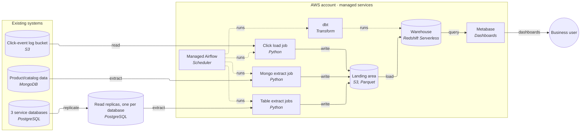
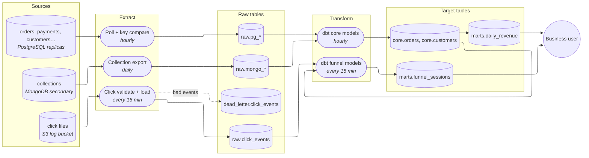

# E-commerce analytics platform — design

## Decision

Build a managed columnar warehouse on AWS (Amazon Redshift Serverless) fed by
batch extracts, transformed with dbt, shown in Metabase, and orchestrated by
managed Airflow. Day one starts with read replicas of the three PostgreSQL
databases, so reporting stops slowing production. The funnel dashboard
refreshes every 15 minutes. Deliberately not built: Kafka, Flink, Spark, or a
lakehouse (open table format on object storage, queried by several engines) —
each solves a problem this company has not yet shown, and the three together
are more than two engineers can run.

This rests on assumptions (see Questions and assumptions): managed services are
acceptable, the two engineers share operation part-time, "real-time" means
about 15 minutes, and the sources hold personal data but no card numbers.

## Architecture

| Component | What it does | Tool |
|---|---|---|
| Read replicas | A continuously updated read-only copy of each PostgreSQL database; all extraction and any ad-hoc reporting reads it, never the primary | Replica of the existing managed PostgreSQL (assumes RDS or Aurora) |
| Table extract jobs | Copy changed rows from each replica to files | Python, run by Airflow |
| Mongo extract job | Reads from a secondary node and copies collections to files | Python, run by Airflow |
| Click load job | Validates click-event files already in the log bucket and writes clean Parquet; bad events go to a dead-letter location | Python, run by Airflow |
| Landing area | Immutable raw copy of everything extracted, partitioned by load date; makes any period replayable | S3 (Parquet) |
| Warehouse | Raw, cleaned and business tables; the only place analysts and BI query | Redshift Serverless |
| Transform | SQL models building cleaned and business tables, with tests | dbt |
| Orchestration | Schedules extracts, loads and dbt; alerts on failure | Managed Airflow (MWAA) |
| BI | Dashboards for finance, ops and product | Metabase (open source) |

## Pipeline

Finance's revenue mart is rebuilt from `core.orders` after the hourly run and
is final each morning. The funnel mart reprocesses a trailing window (the last
two days, so late and out-of-order events land correctly) every 15 minutes.

## Build steps

1. **Read replicas and a reporting login** — delivers: ops' reporting queries
   run against replicas and stop slowing production, within days, before any
   pipeline exists.
2. **Warehouse, landing area, Airflow, and the PostgreSQL extract with dbt
   core models** — delivers: orders, payments and customers from all three
   databases in one place, loaded hourly, with tests that fail loudly.
3. **Daily revenue mart and Metabase** — delivers: finance's daily revenue
   dashboard, one agreed revenue definition, and the first thing the CTO and
   finance can see.
4. **Click load job and the funnel mart** — delivers: product's funnel
   dashboard, refreshed every 15 minutes, with a bad-event dead-letter table
   and alert.
5. **MongoDB export** — delivers: its collections joined into the core
   models (placed here because what it holds, and so who waits for it, is
   still to be confirmed; move it earlier if finance's revenue needs it).
6. **Access controls and the restricted customer table** — delivers: analysts
   and dashboards see only the personal data they need. Parts of this ship with
   steps 2–4 (no raw contact fields loaded from the start); this step closes
   the remaining gaps and reviews who has direct SQL access.
7. **Review at three months** — delivers: a decision, from measured cost and
   freshness, on whether any trigger for the next tier has appeared.

## Why

### Tier

Tier 0, a read replica alone, fixes production slowdown but cannot join three
databases, MongoDB and click events, or keep history the sources drop. It is
built as step 1 and kept as the extraction source.

Tier 1, a Postgres warehouse, was weighed seriously: 230 GB growing 10% a year
would fit. It is rejected on the load known today: 5M click events a day is
about 1.8 billion rows a year (about 58 a second on average, higher at peak),
which a row-store Postgres must scan in full for funnel reports. A 15-minute
funnel refresh recomputes sessionised aggregates that Postgres materialized
views rebuild from scratch each time, on a single node that would also hold
finance's data. The click files are already in S3, which loads natively into a
columnar warehouse. A columnar warehouse (tier 2) is the lowest tier that
fits.

Tier 3, a lakehouse, is rejected: there is no second engine that needs to read
the same data, no machine-learning workload on raw events, no sub-minute
processing requirement, and no observed warehouse-cost problem. Moving up
should follow one of these symptoms, not projected size: (a) several engines
must share the data, (b) raw event volume or warehouse cost outgrows what the
warehouse justifies, (c) a stated need for sub-minute stateful stream
processing. Because the landing area is already open-format Parquet on S3, a
later move up reuses it.

Kafka, Flink and Spark are not needed at this scale: 58 events a second is
trivial for a batch load every 15 minutes, dbt's SQL covers every
transformation listed, and each of the three is a system a two-person team
would own on call.

### Layer table

| Layer | Default | Alternative | Switch when |
|---|---|---|---|
| Warehouse | Redshift Serverless (same AWS account as the click bucket, no new vendor) | Snowflake or BigQuery | The team already knows one of them, or finance's tools integrate with one; or cost per query proves higher than a fixed cluster |
| Landing / raw storage | S3 Parquet | — | — |
| Ingestion (Postgres) | Hourly batch poll from replicas on a change timestamp + key compare | Debezium CDC | Freshness need drops below the hour, or a table hard-deletes and the compare is too slow; slot goes on the replica (see CDC note below) |
| Orchestration | Managed Airflow (MWAA) | Cron / CI running dbt | If MWAA cost looks high for the job count and no one wants to own DAGs |
| Transform | dbt (SQL) | Spark | Logic SQL cannot express |
| BI | Metabase | Superset | Per-group row filtering on a free tool, or advanced visualization is needed |
| Table format | None (warehouse tables) | Iceberg v2 | Tier 3 triggers above; v2 unless every reading engine supports v3 |
| Click streaming | 15-minute batch | Kinesis + Redshift streaming ingestion | Product states a freshness under about 5 minutes — still no Kafka or Flink |

CDC note: if Debezium is adopted later, a replication slot is a server-side
bookmark; on a pre-17 primary it does not survive failover, so put the slot on
a PostgreSQL 16+ read replica (not an Aurora reader — there the slot goes on
the writer), cap WAL with a slot-lag alert, add a heartbeat on quiet tables,
and keep a backfill running through the same version guard.

### Verification

Confirm before building (vendor docs):

- The Redshift Serverless version and the S3 Parquet COPY behaviour for the
  partition layout and column types used (nested JSON in click events: native
  `SUPER` type versus flattening).
- Read-replica support and cross-version limits for the exact RDS/Aurora
  engine versions in use; max standby delay settings so long extracts do not
  get cancelled by replication conflicts (`max_standby_streaming_delay`).
- That Redshift's column-level grants and dynamic data masking cover the
  access paths chosen (Metabase service accounts and direct SQL).
- Metabase open-source limits: no row/column security or per-user
  impersonation, so group isolation is done by separate database connections
  with scoped warehouse users.
- Whether the MongoDB deployment allows reads from a secondary and its oplog
  size, if change streams are ever adopted.
- If Iceberg is adopted later: v2 vs v3 against every reading engine and the
  catalog (Athena cannot read v3; Trino's v3 is experimental).

### Source inventory

| Source | Ingestion method | Delete capture | Failure handling |
|---|---|---|---|
| 3 PostgreSQL databases (orders, payments, customers, etc.) | Hourly poll on `updated_at`, read from the replica; any table lacking a reliable change timestamp is re-read in full (230 GB total, small tables cheap). Freshness allows polling; CDC not needed for daily revenue | Tables that hard-delete: a periodic compare of source keys against stored keys marks missing ones deleted, kept as tombstones in the cleaned layer so a late update cannot resurrect them | Re-readable source: **fail the run**, naming the bad keys and alerting; a rerun of the period recovers once the cause is fixed. Transient errors retry with backoff. Periods come from the run, so any period can be rerun or backfilled |
| MongoDB (~30 GB) | Daily full collection export from a secondary node, or poll on a modified timestamp where collections have one | The full export, compared with stored keys, shows missing documents; recorded as tombstones | Re-readable: fail the run and alert |
| Click events (~5M/day, JSON files in S3) | Every 15 minutes, read new files from the bucket; files stay in place | Not applicable (append-only events) | At this volume a few malformed events are expected, so bad events go to a **dead-letter table** with payload, error and source position (file and offset), an alert on growth, and a named owner (the data team). A reject threshold fails the run if bad events exceed a set share. Redrive is guarded by source position, not event time |

### Serving and model design

- All consumers are dashboards over aggregates for a 150-person company, so
  the warehouse serves them directly; no separate serving store and no reverse
  ETL are needed. If an application later needs point lookups, that gets a
  serving store (Postgres) — not the warehouse.
- Layers: `raw` (as extracted) → `core` (cleaned, deduplicated, tombstoned,
  typed) → `marts` (business-ready: daily revenue, funnel sessions).
- Daily revenue: built from core orders and payments, net of refunds and
  cancellations, in one timezone and currency agreed with finance; orders
  edited after the fact make past days restate, so finance must say whether
  days are frozen after a cutoff.
- Funnel: sessionised in dbt incrementally over a trailing two-day window, so
  late events fix their session without full rebuilds.

### Sensitive data

Customer data (names, emails, phones, addresses) is plainly present in the
service databases, and click events carry user and device identifiers and IP
addresses. Decision per column class:

| Column class | Decision |
|---|---|
| Card numbers / payment instrument details | Never loaded. Keeping them out keeps the platform outside PCI DSS scope. If a source stores full card numbers, escalate it as a compliance issue, not just a column to drop |
| Customer name, address | Not loaded to general tables; loaded to one restricted table keyed by pseudonym, only if a use case (e.g. shipping analysis, support lookup) needs it |
| Email, phone | Not needed for revenue or funnel; where needed only to join or count, a **keyed pseudonym** (HMAC with a secret key, never a plain hash, since hashes of phone numbers are reversed by trying every value). The key is fetched once per extract run from AWS Secrets Manager, so no per-row service call |
| Customer ID, order ID | Kept as internal join keys |
| Date of birth | Derived to age band, source dropped |
| Click IP address | Not loaded raw; derive country/region at load, drop the IP |
| Click user/device IDs | Kept as pseudonymous identifiers |

Access paths: Metabase (one warehouse service account per audience group), and
direct SQL for the two data engineers and any analysts. Because Metabase open
source cannot restrict rows or columns, and BI permissions never apply to
direct SQL, the enforcement sits in the warehouse: Redshift column-level
grants and dynamic data masking, with the restricted table accessible only to
a named role. Finance dashboards read the `marts` schema only.

Erasure is not designed here (no regulated data was named and none was
asked); it is listed as an open question, since the raw landing area keeps
earlier versions of every record.

## Questions and assumptions

1. **Willing to pay for managed or commercial tools?** Assumption: yes —
   managed services (Redshift Serverless, managed Airflow); Metabase stays open
   source. If no, drop to Postgres warehouse, cron-run dbt, self-hosted
   Metabase.
2. **Who operates the platform?** Assumption: the two data engineers, part-time
   on operations, no dedicated platform team and no on-call rota. This is why
   the design uses managed services and one small set of tools.
3. **What freshness does each consumer need, in minutes?** Assumptions:
   finance — final daily revenue by start of business, hourly refresh is fine;
   ops — reporting on a replica, minutes of replica lag acceptable;
   product's "real-time" funnel — 15 minutes. If product means under about 5
   minutes, switch only the click path to Kinesis with Redshift streaming
   ingestion.
4. **Is regulated data in any source?** Assumption: personal data of customers
   (names, contacts, addresses, behavioural identifiers) yes; card data no.
   If the payments database holds full card numbers, that must be escalated
   and kept out of the platform.

## Open questions

- For the owner: what does the MongoDB database hold, and does revenue depend
  on it? (This moves build step 5.)
- For the owner: are the service databases RDS or Aurora, and which engine
  versions? (Affects replica setup and any future CDC.)
- For the owner: do the PostgreSQL tables hard-delete rows, and do they carry a
  reliable `updated_at`?
- For finance: the revenue definition (refunds, cancellations, tax, shipping,
  currency, timezone), and whether past days freeze after a cutoff.
- For product: what refresh time does the funnel dashboard actually need?
- For the compliance owner: which privacy regulations apply (e.g. GDPR), what
  agreements exist with AWS and any BI/messaging vendor, what retention
  periods apply, and how erasure requests are handled — the landing area and
  warehouse would both need an erasure process.
