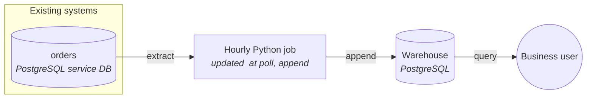

# Current platform

Order data is copied from the orders service's PostgreSQL database into a PostgreSQL warehouse by an hourly Python job. The job selects rows with `updated_at` later than the time of its last run and appends them to the warehouse. Finance reads the warehouse; Ops has no dashboard on order status yet.

## Architecture

## Components

| Component | What it does | Tool | Source |
|---|---|---|---|
| orders | Service database, 40M rows, ~200k changes/day, hard-deletes cancelled orders within 24h, has `updated_at`, sometimes runs multi-minute transactions | PostgreSQL | told by you |
| Hourly job | Selects `updated_at > last_run_time` and appends to the warehouse | Python | told by you |
| Warehouse | Holds order data for reporting | PostgreSQL (may move to a lakehouse later) | told by you |

## Unknown

- PostgreSQL version and hosting of the orders database (self-managed, RDS, Aurora), and whether a read replica exists.
- What schedules the hourly job and where it runs.
- Which tool serves dashboards.
- Which document database, and what the SaaS API is.
