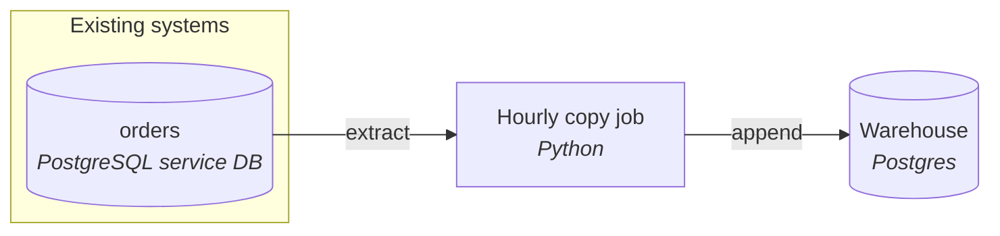

# Current platform

An hourly Python job copies the `orders` table from a PostgreSQL service database into a Postgres-based warehouse. It selects rows whose `updated_at` is later than the last run time and appends them. A lakehouse may replace the warehouse later.

## Architecture

## Components

| Component | What it does | Tool | Source |
|---|---|---|---|
| Service database | Holds `orders` (40M rows, ~200k changes/day, hard-deletes cancelled orders within 24h) | PostgreSQL | told by you |
| Hourly copy job | Selects `updated_at > last_run_time`, appends to the warehouse | Python | told by you |
| Warehouse | Stores the copied orders | Postgres-based | told by you |

## Unknown

- PostgreSQL version and where it is hosted (self-run or a managed service).
- How the job is scheduled, and which dashboard or BI tool is in use.
- What the warehouse's order table looks like (keys, constraints).
