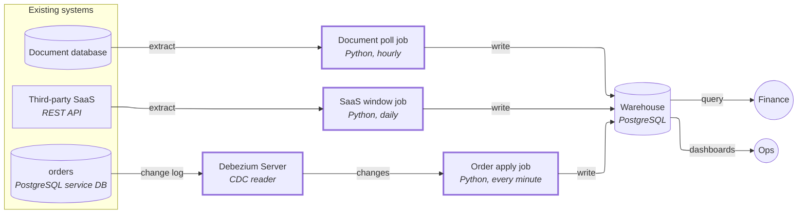
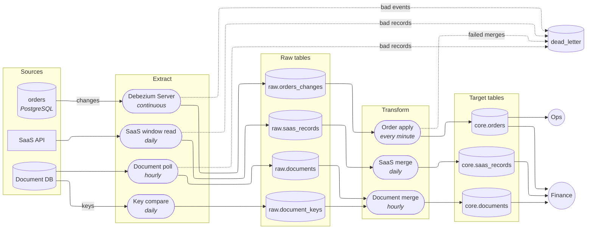

# Ingestion design: orders, document database, SaaS API

## Decision

Build three ingestion paths, each matched to what its source can do. `orders` moves to change data capture (CDC: reading the database's own change log, which records every insert, update and delete, in commit order); the document database is polled on a change timestamp with a periodic key compare for deletes; the SaaS API is re-read over its whole 30-day editable window on every run. All three land in append-only raw tables and are merged into clean tables by an idempotent upsert, so a retried or repeated run can never create duplicates. The hourly `updated_at` job is retired for `orders`; there is no new streaming platform (no Kafka), and no lakehouse is built now, though the raw layer is kept replayable so it can feed one later.

This rests on assumptions: managed services are not required, the `orders` database is PostgreSQL 16 or later and allows logical replication, the document database has a modification timestamp on its records, and the SaaS data needs to be fresh daily (see Questions and assumptions).

## Architecture

Boundaries are omitted because where each component runs is not yet known. The hourly Python job is replaced; the warehouse is unchanged.

| Component | What it does | Tool |
|---|---|---|
| Debezium Server (new) | Reads the `orders` change log through a logical replication slot (the server-side bookmark of how far it has read) and emits one event per change, each carrying its log position | Debezium Server, PostgreSQL connector |
| Order apply job (new) | Appends events to `raw.orders_changes`, then merges them into `core.orders` every minute, keeping the change with the highest log position per order | Python, SQL |
| Document poll job (new) | Hourly: reads records changed since the last successful run minus an overlap, appends to raw, merges by key; also runs a daily key compare to detect deletes | Python |
| SaaS window job (new) | Daily: re-reads the last 30 days page by page within the rate limit, appends to raw, merges by record id | Python |
| Warehouse (unchanged) | Stores raw and clean tables; serves finance queries and the Ops dashboard | PostgreSQL |

## Pipeline

## Build steps

1. Run the current job's output against the source to size the damage — delivers: finance gets a list of the orders duplicated or missing since the job began, and a clean-up of the duplicates.
2. Create `core.orders` with a unique key on order id, and a merge that only accepts a change if its log position is higher than the stored one — delivers: a repeated or retried load cannot create a second copy of an order.
3. Set up CDC on `orders`: logical replication slot, Debezium Server, WAL cap and slot-lag alert, heartbeat — delivers: every change and delete in `orders` arrives in the warehouse as it happens.
4. Load the existing 40M rows through the connector's incremental snapshot, using the same merge — delivers: `core.orders` is complete and live without a separate bulk load that could overwrite newer rows.
5. Run the minute-by-minute apply job and point the Ops dashboard at `core.orders` — delivers: Ops sees an order status change within about a minute.
6. Run the old hourly job and the new path side by side for a week, with a daily reconciliation of order keys and counts against the source, then switch off the hourly job — delivers: finance's numbers are checked before they depend on the new path.
7. Add the document poll job with overlap, upsert by key and the daily key compare — delivers: document data in the warehouse hourly, with deleted records marked.
8. Add the SaaS window job with page checkpoints and rate-limit pacing — delivers: SaaS data in the warehouse including edits made up to 30 days after creation.
9. Put dead-letter tables, growth alerts and a named owner on every path — delivers: bad records are visible and recoverable instead of silently lost or blocking a run.

## Why

### Source inventory

**Why the duplicates happened.** The job appends. A run that failed halfway had already written some rows; the retry selected the same `updated_at` range and wrote them again. A repeat is only harmless if the write is a merge by key, which is what every path below uses. Two more faults sit in the same job: `updated_at > last_run_time` loses rows whose transaction commits after the run reads (a transaction lasting minutes stamps `updated_at` at write time but is invisible until commit, so its rows are older than the watermark when they finally appear), and it never sees hard deletes.

| Source | Ingestion method | Why | Delete capture | Failure handling |
|---|---|---|---|---|
| `orders` (PostgreSQL, 40M rows, ~200k changes/day) | CDC with Debezium Server | The change log delivers events at commit in commit order, so multi-minute transactions are not missed; it sees the hard deletes of cancelled orders, which a poll cannot; it meets the one-minute need that an hourly poll cannot. About 2–3 changes per second does not justify Kafka: Debezium Server with a small writer into the warehouse is enough for a small team. | Delete events become tombstones in `core.orders` (a row kept with `is_deleted` and `deleted_at`, never physically removed), so a late or redriven update cannot bring a cancelled order back. Dashboards and finance views filter `is_deleted`. | See below |
| Document database | Batch poll on its modification timestamp, hourly, reading from the last successful watermark minus an overlap (for example 1 hour) | The tooling has no CDC for it, and hourly freshness is assumed enough. The overlap and a merge by key make a re-read harmless and cover records that commit late. | A daily compare of the source's keys against the stored keys; keys missing at the source are tombstoned. Deletes therefore show up with up to a day's delay. | See below |
| SaaS REST API | Windowed re-read: each run reads everything created or modified in the last 30 days, not just new records, merged by record id | Data is editable for 30 days, so a record read once can change later; only re-reading the window catches the edits. Past 30 days a record is final and is no longer read. | Records in the window that are missing from the re-read are tombstoned. | See below |

**Failure handling, common to all paths.**

- Transient failures (network, rate-limit responses, source restarts) retry with backoff. Only poison records, those that can never succeed, go to the dead-letter table, each keeping its payload, error and **source position** (log position for `orders`; record key and modification time for the others).
- Redrive from the dead-letter table is guarded by source position, not `updated_at`: timestamps tie and drift, so an old record could overwrite a newer one. For `orders` the merge accepts a change only if its log position exceeds the stored one.
- Deletes are kept as tombstones in the clean layer, for the reason above.
- Batch runs take their period from the run, not from "now", so any period can be rerun or backfilled and gives the same result.
- A growing dead-letter table raises an alert, and each path has a named owner (see Open questions).

**Path-specific risks and their mitigations.**

- *WAL cap plus slot-lag alert.* An uncapped slot can fill the primary's disk when the reader stops; a capped one is dropped if it falls too far behind, forcing a new snapshot. The cap is sized for the longest outage tolerated, and lag alerts fire well before it.
- *Slot placement.* Failover is assumed to matter: on a PostgreSQL 17+ primary, failover slots keep the slot across promotion. Before 17, a slot on the primary is lost on failover, risking a gap and a re-snapshot, so on 16 the slot goes on a read replica (it survives promotion of that replica; the cost is that the replica must send feedback to the primary, which delays vacuum there). On Aurora PostgreSQL the slot must be on the writer. If logical replication is not allowed on the source at all, the fallback is the existing poll with a key compare, which gives roughly hourly freshness and fails the one-minute dashboard need.
- *Heartbeat.* `orders` may go quiet overnight; a slot that sees no change stops advancing and pins WAL. A heartbeat write keeps it moving (written on the primary if the slot is on a replica).
- *Unchanged large columns.* If `orders` has large text or jsonb columns, unchanged ones arrive as a placeholder; the merge must keep the stored value rather than write the placeholder over it.
- *Backfill beside the live stream.* The 40M-row load and any later re-load use the connector's incremental snapshot through the same position-guarded merge, never a bulk load over newer rows.
- *Document database.* The poll depends on a reliable modification timestamp; records updated without touching it are only caught by an occasional full re-read, scheduled as a weekly check.
- *SaaS rate limit.* Re-reading 30 days daily must fit the quota: the job paces requests, checkpoints after each page so a failure resumes at that page rather than the start, reads in a stable sort order, and, if the window cannot be read within quota, widens the interval before it shrinks the window. Each run's result is merged only after the full window is read, so a half-read window never tombstones records.
- *Lakehouse later.* Raw tables keep every change and its position, so they can be replayed into a lakehouse table through the same merge; the sources and jobs need no redesign.

## Questions and assumptions

1. **Willing to pay for managed or commercial tools?** Assumption: no; open-source, self-hosted (Debezium Server, Python jobs, the existing PostgreSQL).
2. **Who operates this?** Assumption: one or two engineers part-time. This is why the design avoids Kafka and a new orchestrator; the jobs run on whatever schedules the hourly job today.
3. **What freshness does each consumer need, in minutes?** Given: Ops needs order status within 1 minute. Assumed: finance's `orders` figures are fine at a few minutes behind; the document data within an hour; SaaS data within a day.

Also assumed (not asked by the situation): the `orders` database is PostgreSQL 16+ with logical replication permitted; the document database has a modification timestamp.

## Open questions

- Which PostgreSQL version and host does `orders` run on, and is there a read replica? This decides slot placement.
- Which document database is it? If it is one whose change log can be read with the tooling the team already trusts, CDC would replace the poll and catch deletes immediately. The team says the tooling has none, so the design does not rely on it.
- Does the document database update a modification timestamp on every write, and are records hard-deleted?
- Which SaaS API: its rate quota, whether it exposes a modified-since filter, and whether it reports deletions?
- Does finance need the SaaS data more often than daily?
- Who owns each dead-letter table and the slot-lag alert?
- Do `orders` rows carry large text or jsonb columns?
