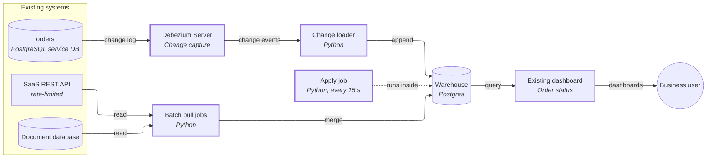
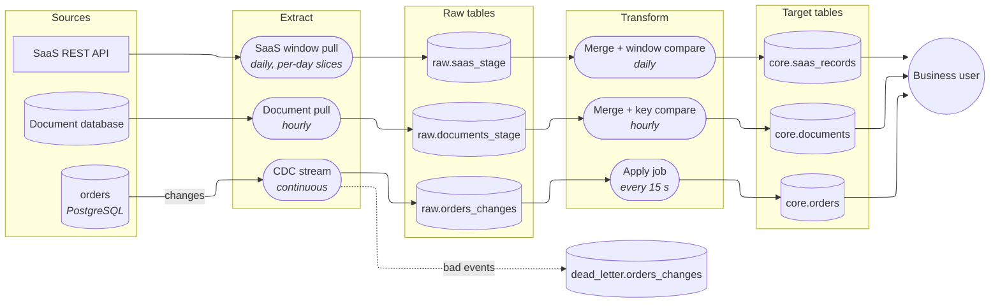

# Ingestion design: orders, document database, SaaS API

## Decision

Replace the hourly `updated_at` poll of `orders` with change data capture (CDC: reading the database's own change log, which records every insert, update and delete in commit order). Changes land in an append-only change table, and a small apply job merges them into the current-state table every 15 seconds, so order status reaches the dashboard well inside a minute. The document database and the SaaS API stay batch pollers, made safe to rerun, and no streaming is built for them. The design assumes the orders PostgreSQL server allows logical replication (the setting CDC needs) and that the other two sources need freshness of about an hour; neither is confirmed (see Questions and assumptions).

Why the duplicates happened: the job appends, so a run that failed halfway and was retried wrote the same rows twice. Every path below writes by key with a version check, so a retry changes nothing.

## Architecture

New components are drawn with a thick border. The warehouse and dashboard stay as they are. The old hourly copy job is retired for `orders` once the new path is verified.

| Component | What it does | Tool |
|---|---|---|
| Debezium Server | Reads the orders change log and emits one event per insert, update and delete, each carrying its log position (LSN: the monotonically increasing position in the change log) | Debezium 3.x |
| Change loader | Writes events to `raw.orders_changes`, unique on (order id, LSN) so a replayed event is ignored; sends events it cannot parse to the dead-letter table | Python |
| Apply job | Merges new rows from `raw.orders_changes` into `core.orders`, only when the incoming LSN is newer than the stored one; a delete becomes a tombstone (a row kept with a deleted flag) | Python + SQL in the warehouse |
| Batch pull jobs | One per batch source: read a period, load it into a staging table, merge by key into the current-state table | Python |
| Warehouse | Holds raw change/snapshot tables and current-state tables | Postgres |
| Dashboard | Reads `core.orders` for status | Existing |

## Pipeline

Only the CDC stream has a dead-letter table; the two batch sources fail the run on a bad record (reasons in the source inventory).

## Build steps

1. **Clean up and protect the current table** — delivers: finance's duplicates are removed and cannot recur. Deduplicate the existing warehouse orders table by order id, keeping the newest row, and put a unique key on it so a retried load fails loudly instead of doubling rows.
2. **Capture setup on the orders database** — delivers: a change log is flowing, with nothing yet read by reports. Enable logical replication, create the replication slot (the server-side bookmark the reader resumes from), cap how much log it may retain, and add a lag alert and a heartbeat (a periodic dummy write so a quiet table doesn't pin the log).
3. **Initial load beside the live stream** — delivers: `core.orders` holds all 40M orders with live changes already applied. Backfill with an incremental snapshot that goes through the same LSN check as live events, never a separate bulk load that could overwrite newer rows.
4. **Apply job and tombstones** — delivers: the dashboard shows status within a minute of a change, and cancelled (deleted) orders disappear from reports but remain as tombstones for audit.
5. **Dead-letter table, alert and owner** — delivers: a bad event is visible and recoverable instead of blocking the stream or vanishing.
6. **Parallel run and reconciliation** — delivers: proof the new path matches the old one. Run both for a period, compare row counts and key sets between the source and `core.orders` nightly, then retire the hourly copy job for `orders`.
7. **Document database pull** — delivers: its data refreshed hourly, safe to rerun, deletes reflected.
8. **SaaS window pull** — delivers: records stay correct for the 30 days they can be edited, within the API's rate limit.

## Why

### Source inventory

| Source | Ingestion method | Delete capture | Failure handling |
|---|---|---|---|
| `orders` (PostgreSQL, 40M rows, ~200k changes/day ≈ 2–3 per second) | CDC. A poll on `updated_at` can't meet the one-minute need cheaply, can't see rows that were hard-deleted, and misses rows from long transactions: a transaction that runs several minutes stamps rows with a time earlier than the poll's cutoff, and the rows become visible only after the poll has already passed that time. The change log is ordered by commit, so none of that applies. | Native: the log carries each delete; the apply job writes a tombstone and a late or replayed update with an older LSN cannot bring the order back. | Dead-letter table, because a stream cannot stop for one record and the log position is bounded by the slot's retention. Each dead-letter record keeps payload, error and LSN; redrive is guarded by LSN, not `updated_at` (timestamps tie and drift). Alert on growth; owner: the data engineer on call. Transient errors retry with backoff. |
| Document database | Batch poll hourly on its change timestamp, re-reading from the last *successful* period start minus a safety overlap, merged by document key. The period comes from the run, never the wall clock, so any period can be rerun or backfilled. If a collection has no reliable change timestamp, it is re-read in full and compared by content hash. | A hard delete leaves no trace in a poll, so each run compares the source's full key list with the stored keys; keys missing from the source get a tombstone. | Fail the run: the source can be read again, so the run stops naming the bad keys, alerts, and a rerun recovers once the cause is fixed. Loads go to a staging table and are merged by key in one transaction, so a half-finished run leaves nothing partial. |
| SaaS REST API (rate-limited, paginated, records editable 30 days) | Daily batch that re-reads the whole trailing 30-day window (plus one day of margin), not only new records, since edits are not visible otherwise. The window is cut into per-day slices, each its own checkpoint, so a failure or an expired pagination cursor reruns one slice rather than the window. Requests honor the rate limit with backoff and spread out; the number of requests per run is the thing to size against the limit. Rows older than the window are final and are written once. | If the API offers no delete signal, a record that appears in the stored window but not in the re-read is tombstoned. | Fail the run, same reasoning as above: the window stays editable and re-readable. Reruns merge by record key, so a retry cannot duplicate. |

### Other mechanisms, one line each

- **WAL cap plus slot-lag alert** — an uncapped slot can fill the orders server's disk; a capped one is dropped if it falls too far behind and forces a re-snapshot, so the alert fires well before the cap.
- **Heartbeat on quiet tables** — an idle table stops the slot advancing and pins log on disk.
- **Slot survival** — before PostgreSQL 17 a slot on the primary does not survive failover and recreating it risks a gap and a re-snapshot; the slot's placement depends on the version and hosting (open question).
- **Unchanged large columns** (large text/jsonb) arrive as a placeholder; the apply job keeps the stored value when it sees the placeholder instead of overwriting it.
- **Transaction boundaries** — if order items must stay consistent with orders, they join the same capture and the apply job applies per transaction. Only `orders` is in scope here.
- **Lakehouse later** — `raw.orders_changes` is an append-only, ordered change log, which maps directly onto a lakehouse table format; moving means changing the loader's destination and the merge, not the capture.

## Questions and assumptions

Question (freshness, in minutes, for each consumer): the one-minute need is stated for order status only.
- Assumption: the document database and SaaS data are used for reporting where an hour (documents) and a day (SaaS) is enough. If either needs fresher data, the SaaS window pull becomes more frequent and is limited by the API rate limit; the document database would need a change stream, see Open questions.

## Open questions

- **PostgreSQL version and hosting for `orders`** (owner: platform/DBA). Decides where the replication slot lives: on the primary it needs PostgreSQL 17 failover slots to survive a failover, on a read replica it needs 16+ and not an Aurora reader, and a managed service that blocks logical replication forces the fallback of an hourly poll with a key compare, which gives roughly hour-old status, not one minute.
- **Which document database, and why "no CDC in our tooling"?** If it is MongoDB 4.4+, change streams exist and could replace the poll; the tooling gap may be a missing connector rather than a database limit. The batch design holds either way. Does each collection have a reliable change timestamp, and are deletes hard or soft?
- **SaaS API**: does it offer a modified-since filter or a deletion feed, and how many records fall in a 30-day window against the rate limit? That sets whether a daily full-window re-read fits.
- **Scheduler and dashboard tools** are not recorded; the design needs only something that runs the batch jobs with run-period parameters.
