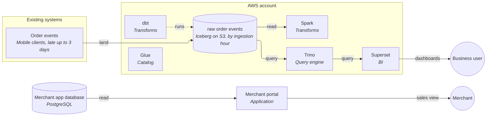

# Current platform

An AWS lakehouse. Raw order events land as Iceberg tables on S3, partitioned by ingestion hour, and have accumulated millions of small files, so queries are slow. Spark and dbt transform the data, Trino queries it, and Superset serves dashboards. Separately, the merchant portal is an application backed by its own PostgreSQL database, which today computes each merchant's daily sales live.

## Architecture

## Components

| Component | What it does | Tool | Source |
|---|---|---|---|
| Raw order events | Order events as Iceberg tables on S3, partitioned by ingestion hour | Iceberg on S3 | told by you |
| Catalog | Registers the tables | AWS Glue | told by you |
| Transforms | Turn raw data into usable tables | Spark, dbt | told by you |
| Query engine | Answers SQL queries | Trino | told by you |
| BI | Dashboards | Superset | told by you |
| Merchant app database | The merchant portal's own data; it computes daily sales live today | PostgreSQL | told by you |
| Merchant portal | Shows each merchant their sales | Application (ours) | told by you |

## Unknown

- How events get from mobile clients into the raw tables (the landing mechanism).
- What schedules the Spark and dbt jobs, and where Spark runs (EMR, Glue, other).
- Whether the portal's PostgreSQL is managed (RDS/Aurora) or self-run.
- Which Iceberg table-format version the existing tables use.
- Whether any layers exist above raw today.
