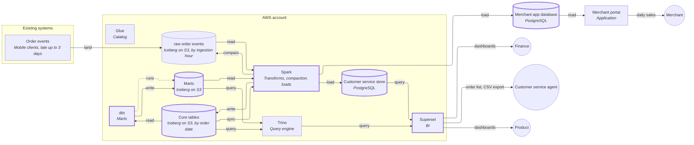
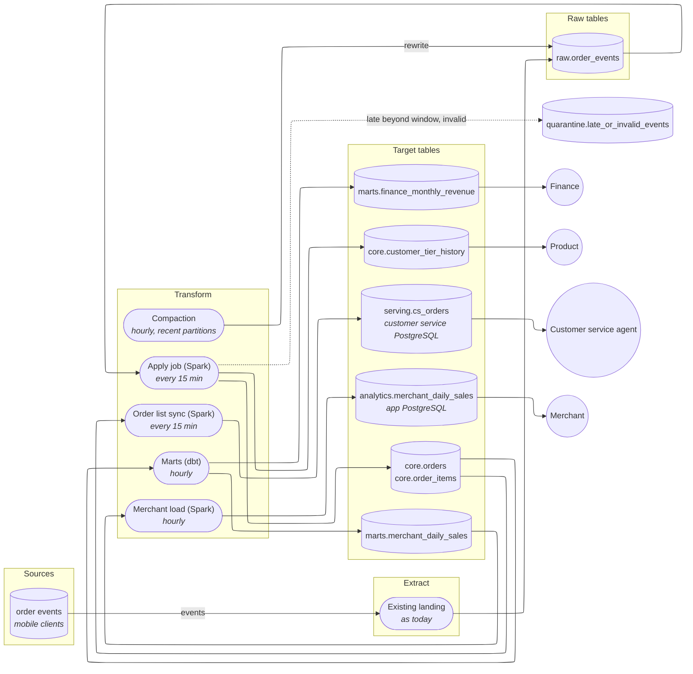

# Order analytics: finance, customer service, merchant portal, loyalty history

## Decision

Keep the lakehouse as it is and add three things on top of the raw order events: a one-off fix for the small-file problem (a compaction job), a cleaned "core" layer that holds one current row per order plus a loyalty-tier history, and a few purpose-built outputs. Finance gets a monthly revenue table in the lake that Superset reads through Trino. Customer service gets a copy of the order list in a new, separate PostgreSQL database, because ~200 people running row-level searches all day is the wrong load for Trino. The merchant portal gets pre-computed daily sales loaded into a schema the pipeline owns inside the app's PostgreSQL, so the app stops computing them live. Nothing is moved off Iceberg, Spark, dbt, Trino or Superset.

This rests on these assumptions: a managed PostgreSQL in the existing AWS account is acceptable for customer service; the loyalty tier is carried on the order events (see Questions); and Iceberg format v2 is used for all new tables.

## Architecture

New and changed components have a thick outline.

| Component | What it does | Tool |
|---|---|---|
| Raw order events (changed) | Stays as it lands, by ingestion hour; a compaction job merges its small files into large ones | Iceberg v2 on S3 |
| Core tables (new) | One current row per order, its line items, and the loyalty-tier history; partitioned by order date. The cleaned layer every output reads from | Iceberg v2 on S3, written by Spark |
| Marts (new) | Finance's monthly revenue and merchants' daily sales, pre-computed | Iceberg v2 on S3, built by dbt |
| Spark (changed) | Compaction, raw-to-core jobs, and the two loads into PostgreSQL | Spark |
| Customer service store (new) | A searchable copy of orders with the indexes agents' filters need | PostgreSQL (managed, in the AWS account) |
| Superset (changed) | New finance and product dashboards over Trino; new order-list dashboard over the customer service store | Superset |
| Merchant app database (changed) | Gains a read-only `analytics` schema owned by the pipeline | PostgreSQL |
| Merchant portal (changed) | Reads the pre-computed aggregates instead of computing them | Application |
| Catalog, Trino | Unchanged | Glue, Trino |

## Pipeline

## Build steps

1. Compact the raw tables — delivers: queries on raw data get fast. A job merges small files into ~256 MB files, hourly for recent partitions and once more when a partition is old; a daily job expires old snapshots, removes orphan files and compacts metadata, so the file count stays down.
2. Core orders and items — delivers: one trustworthy, fast table of orders. The apply job reads new raw hours plus the trailing 4 days, drops duplicates by event id, and merges into the core tables; an older event never overwrites a newer state.
3. Finance monthly revenue — delivers: finance's report by region and product category in Superset. Months touched by late or changed events are recomputed.
4. Loyalty tier history — delivers: product can see each customer's tier over time.
5. Customer service store and order-list dashboard — delivers: agents search by customer, status and date and export CSV, without touching the lake.
6. Merchant daily sales load, then portal switch — delivers: merchant sales pages load from pre-computed rows and the portal's live computation is removed, freeing app database CPU and memory.
7. Monitoring — delivers: alerts on file counts, job lateness, quarantine size, and mismatches between the finance, merchant and order-list totals.

## Why

### Serving and model design

**Table format.** All new Iceberg tables use format **v2**. v3 (deletion vectors, row lineage) is not readable by every engine yet: Athena cannot read it and Trino's support is experimental, and Trino is the query engine here. Move to v3 only when every engine that reads the tables supports it.

**Small files.** Raw is partitioned by ingestion hour, so every hour holds many tiny files and nothing downstream should query it directly. The fix is compaction plus not querying raw: dashboards read core and marts. Raw keeps its ingestion-hour partitioning because it makes "what arrived since last run" a cheap read. Core is partitioned by order date, at day grain (hourly partitions are what created the problem), and written in large batches.

**Late events (up to 3 days).** A late event arrives in a *new* ingestion hour, so it is found by reading new hours; the trailing window of 4 days (3 plus one day of margin) re-reads recent hours so a failed or delayed run recovers itself. Merging is by order id and keeps the version with the latest event time, so a late older event cannot overwrite a newer state, and rerunning gives the same result. Every mart is rebuilt for each order date or month an arriving event touches, by overwriting that partition, never by adding to it. An event older than the window is not applied silently: it goes to the quarantine table, where its count is monitored.

**Finance: monthly revenue by region and product category.** It is an aggregate, so it stays in the lake as `marts.finance_monthly_revenue` (month, region, product category, revenue) and is read through Trino by Superset. Because events can arrive 3 days late, a month's figure can still change for 3 days after month end; the table carries a "provisional" flag until the 4th, and the dashboard shows it. Revenue is defined once, in the dbt model, so there is a single definition (assumed: completed orders, net of refunds, line amount times quantity; see Open questions).

**Customer service: searchable order list, ~200 agents, CSV export.** This is a known, constant load of many concurrent row-level lookups, so it goes to a serving store, not Trino (which is built for fewer, larger analytic queries). `serving.cs_orders` in a new managed PostgreSQL holds one row per order (customer, status, order date, amounts, items summary) with indexes on customer, status and order date; it is synced from `core.orders` every 15 minutes by upserting changed orders only. A separate database means agents can never slow the merchant app. Agents use a Superset table dashboard on this store, with filters for customer, status and date range and Superset's CSV export. The customer's name and contact details are in scope because agents need them: the store has a restricted `cs_agent` role with read-only access to this one table; export has a row cap (assumed 50,000) and is limited to agent and supervisor roles; every export is logged. Policy questions (retention of this copy, which fields agents may export) are in Open questions. The sync follows the whole-load rule below.

**Merchant portal: daily aggregates.** Reverse ETL: `marts.merchant_daily_sales` (merchant, date, orders, units, gross and net sales) is loaded into a read-only `analytics` schema inside the app's PostgreSQL. The pipeline owns that schema; the app only reads it and never writes there, so an app write and a load can't collide, and the pipeline never writes into the app's own tables. Each load is built in a staging table and then swapped in within a single transaction, so each load becomes visible whole and the portal never shows a half-loaded day. The load replaces the trailing days (late events change them), and the portal always filters by the signed-in merchant's id. This removes the live aggregation from the app's database; the app now only does indexed reads of a small table. Data is at most about an hour old.

**Product: loyalty tier over time.** `core.customer_tier_history` is a slowly-changing-dimension (type 2) table: one row per customer per tier with `valid_from`, `valid_to` and `is_current`. It is built from tier changes in event-time order, so a late event rebuilds only that customer's rows (the intervals before and after it are corrected). The table is small and not partitioned. History is only as old as the first data the events carry; changes before that cannot be reconstructed.

**Freshness assumed (per consumer, in minutes).** Customer service order list: 15. Merchant daily sales: 60. Finance and product: daily is enough; they refresh hourly at no extra cost.

## Questions and assumptions

One batch, for the owner. Each has an assumption so the design could proceed.

1. **How fresh must each consumer be, in minutes?** Assumed: order list 15, merchant sales 60, finance and product daily.
2. **Is a managed PostgreSQL (a new RDS/Aurora instance) acceptable for the customer service store?** Assumed: yes, since you already run on AWS.
3. **Who operates the platform** — a data platform team or part-time engineers? Assumed: an existing team already runs Spark, dbt, Trino and Superset, so one more small database and a few jobs fit.
4. **Is any of the order data regulated** (card data, health data)? Assumed: personal data only (customer names and contact details), no card or health data.
5. **Where does the loyalty tier come from?** Assumed: each order event carries the customer's tier at event time. If the tier lives only in another system (for example the app database), it becomes a new source and needs its own ingestion design to capture changes.

## Open questions

- Finance: revenue definition (cancelled and refunded orders, discounts, tax, shipping), currency conversion, and what "region" means (customer's or merchant's). Whether a closed month is restated for late events or frozen after the 4th.
- Merchant portal: which time zone defines a "day" for each merchant, and whether late changes to past days are acceptable to show.
- Customer service: whether agents may see full contact details or masked ones by default, retention of the PostgreSQL copy, and whether agents will use Superset or an existing support tool that should be fed from `serving.cs_orders`.
- Erasure: if a customer requests deletion, it must also be applied to `serving.cs_orders` and to core; this needs an owner to confirm before go-live.
- What schedules the jobs and where Spark runs: the schedule above assumes your existing scheduler can run jobs every 15 minutes.
