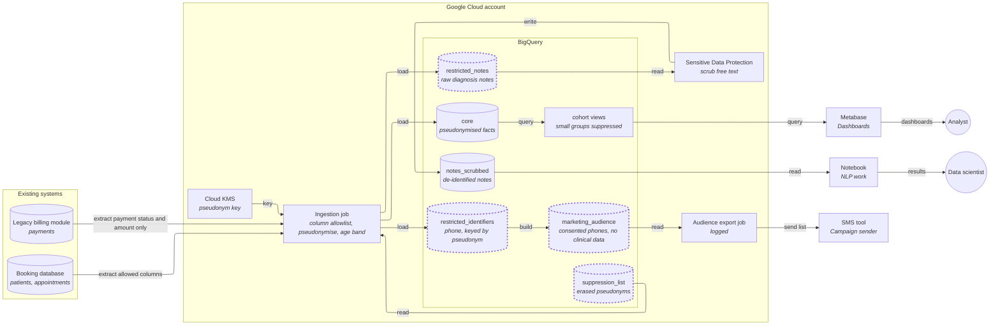

# Clinic booking analytics — sensitive data and governance

## Decision

Patient data enters BigQuery through a single ingestion job that passes only an
approved list of columns, replaces patient identity with a keyed pseudonym
(a stand-in ID that only the holder of a secret key can link back to a person),
turns date of birth into an age band, and routes identifiers and free-text notes
into separate restricted datasets. Analysts and Metabase see only the
pseudonymised `core` dataset. Card numbers from the legacy billing module and
national IDs are never loaded, and patient names are not loaded either because no
requested use needs them. Marketing gets a consented audience list exported to
the SMS tool, not access to phone numbers. The data scientist gets a scrubbed copy
of the notes by default, with the raw notes in a restricted table behind named
approval.

The design assumes managed Google Cloud services are acceptable (BigQuery, Cloud
KMS, Sensitive Data Protection), that the booking system has an internal patient
ID, and that the regulated-data answer is "yes" (see Questions and assumptions).

## Architecture

Dashed outlines are restricted datasets: no analyst, Metabase or default group
has access to them.

| Component | What it does | Tool |
|---|---|---|
| Booking database | Source of patients and appointments | As it exists today |
| Legacy billing module | Source of payments; stores full card numbers (escalated, see Why) | As it exists today |
| Ingestion job | Reads only allowlisted columns, computes the pseudonym and age band, splits identifiers and notes into restricted datasets, skips suppressed people | Chosen in the ingestion design; must support a column allowlist and secret-manager keys |
| Pseudonym key | Secret key for the keyed pseudonym; held apart from the data, readable only by the ingestion job | Cloud KMS |
| `core` | Appointments and payments with pseudonym, age band, diagnosis category; no direct identifiers | BigQuery |
| `restricted_identifiers` | Phone (and any other contact needed), keyed by pseudonym | BigQuery, column and dataset access limited to a small named group |
| `restricted_notes` | Raw diagnosis notes keyed by pseudonym | BigQuery, same restriction |
| `notes_scrubbed` | Notes with names, phones, IDs and card-like numbers removed | Sensitive Data Protection writing to BigQuery |
| `marketing_audience` | Patients with recorded SMS consent: pseudonym and phone only, no diagnosis, no age band | BigQuery |
| Audience export job | Sends the audience to the SMS tool; writes a log of who, when, how many | Scheduled query or job; SMS tool is a third party |
| Cohort views | Counts by age band and diagnosis category; groups under a minimum size are hidden | BigQuery views |
| `suppression_list` | Pseudonyms of erased people, read by every load, backfill and restore | BigQuery |
| Metabase | Dashboards for analysts, connected to `core` and the cohort views only | Metabase |
| Notebook | Where the data scientist works, reading `notes_scrubbed` | Hosting not decided (see Open questions) |

## Build steps

1. Escalate the card storage in the legacy billing module to its owner and
   compliance — delivers: a named owner and a decision on removing or tokenising
   stored card numbers, so the risk is tracked outside this project.
2. Agree the column allowlist with source owners: only listed columns may leave a
   source — delivers: a reviewed list, and card numbers, national ID and names
   structurally unable to reach the warehouse.
3. Create the pseudonym key and the ingestion job's use of it — delivers: a stable
   patient pseudonym that links an analyst's data across tables but cannot be
   reversed from the data alone.
4. Create the datasets and access groups: `core` and cohort views for analysts and
   the Metabase service account; restricted datasets for named groups only; set
   the restricted datasets' time travel to the 2-day minimum — delivers:
   analysts and Metabase can query, and cannot reach identifiers or notes.
5. Load `core` with age band and diagnosis category in place of date of birth and
   notes — delivers: cohort dashboards by age group and diagnosis in Metabase,
   with small groups hidden.
6. Load `restricted_identifiers` and `restricted_notes`; scan notes for card-like
   numbers on the way in and quarantine any hit — delivers: raw data held once,
   in two small tables.
7. Build `notes_scrubbed` and agree with the data scientist that it is good enough
   to train on — delivers: an NLP dataset with no direct identifiers.
8. Build `marketing_audience` from recorded consent and the export job with its
   log — delivers: marketing can run SMS campaigns without seeing a phone number.
9. Build the erasure pipeline, request log and suppression list, and test one
   erasure end to end — delivers: a patient's request can be completed and
   proven within a stated deadline.

## Why

### Sensitive data

**Every way people reach the data.** Metabase, direct SQL in BigQuery, the data
scientist's notebook, and the audience export to the SMS tool. Metabase queries
BigQuery through one service account, so per-user BigQuery rules never apply to
dashboard viewers and Metabase's own permissions protect only Metabase users.
That is why the control does not live in Metabase: the Metabase service account
simply has no access to any restricted dataset, and `core` holds no direct
identifier, so whichever Metabase edition is used cannot expose one. BigQuery is
the single engine, so its dataset permissions and column-level policy tags are
the primary control for the other paths.

| Column / source | Decision | Reason |
|---|---|---|
| Card numbers (legacy billing) | **Never loaded.** Only payment status, type and amount are extracted. Escalated to the billing owner and compliance as a compliance issue, not just a dropped column | Loading even one copy brings the whole warehouse, Metabase and every analyst into card-industry (PCI DSS) scope, which no access control undoes. Also excluded from dead-letter payloads and notes (build step 6) |
| National ID | **Not loaded.** Patient identity comes from the booking system's internal patient ID | No requested analysis needs the value; joins use the pseudonym |
| Internal patient ID | **Keyed pseudonym** (keyed hash with a secret held in Cloud KMS) in all tables | A plain hash of a phone or ID is reversed by hashing every possible value. BigQuery's built-in SHA-256 masking rule is such a plain hash and is not used for this |
| Patient name | **Not loaded** | No requested use. If support later needs it, it goes in the restricted table, not `core` |
| Date of birth | **Derived, source dropped**: age band at appointment date (for example 0–17, 18–29, … 75+) | Cohorts need a band only. Bands are wide enough to hold groups of a useful size |
| Diagnosis (structured category/code) | In `core` as a category | Needed for cohorts; assumed to exist (see assumptions). Health data, so `core` is treated as sensitive: named groups only, no public or all-staff access |
| Diagnosis notes (free text) | **Raw** in `restricted_notes`, keyed by pseudonym, nobody by default, read only by named approval. **Scrubbed copy** in `notes_scrubbed` for the data scientist | Free text routinely contains names, phones and sometimes card numbers, so it cannot sit in `core`. A model trained on scrubbed text answers the request without exposing identifiers; raw is granted only if the scrubbed text proves insufficient, and only inside the platform |
| Phone | `restricted_identifiers` keyed by pseudonym. Marketing never queries it; they get `marketing_audience` (consented patients only) exported by a logged job | Raw value is needed only to send the SMS. The audience table carries no diagnosis or age band so marketing targeting does not use health data |

**Small groups.** Age band × diagnosis can identify a person when a group is tiny
(a rare diagnosis in one band). Cohort views hide groups under a minimum size
(proposed 10, confirmed with the compliance owner), and Metabase connects to the
views, not to `core` rows. Analysts needing row-level `core` data go through
BigQuery directly and a named group, not Metabase.

**Third parties.** The SMS tool receives phone numbers and so is a processor of
personal data; the export is limited to the audience table and logged.

### Erasure

Erasure is its own pipeline, because the raw copies keep every earlier version
and any rebuild would restore what was erased. A request goes through these
steps:

- **Log the request** (date, scope, who verified identity) as the audit record.
- **Resolve** the person to their pseudonym using the key.
- **Reach every copy**: staging files from ingestion, `restricted_identifiers`,
  `restricted_notes`, `notes_scrubbed`, `marketing_audience`, the SMS tool's
  list (deleted through its interface or API), exports and notebook
  extracts, and `core`. Rows are overwritten in place, not removed: identifiers
  and notes are deleted, and in `core` the pseudonym is replaced with a random
  value that links to nobody, so appointment and cohort totals stay the same.
- **Deadline includes platform retention.** BigQuery keeps deleted data in time
  travel (set to 2 days on restricted datasets, 7 by default) and 7 more days
  in fail-safe that cannot be purged, so the true deadline is the response period
  minus about 9 days (14 on datasets left at the default).
- **Suppression list**: the erased pseudonym is added before deletion, and
  ingestion, backfills and any restore from backup read it and skip that
  person, so a replay cannot bring them back.
- **Zero-match check**: before closing the request, query every copy for the
  pseudonym and original identifiers and record that none match.
- **Not crypto-shredding**: destroying the pseudonym key would not erase
  anything, because the encrypted or pseudonymised data is still personal data
  and would remain in every copy. The key is therefore never deleted as a way
  of erasing.
- **Models trained on notes** are a copy of the data in a different form; see
  Open questions.

## Questions and assumptions

Question asked: *Is any source regulated (personal, card or health data)?*
Answer from the request: yes — personal data (name, national ID, phone, date of
birth), health data (diagnosis notes) and card data (legacy billing).

Assumptions the design rests on (correct any that is wrong):

- Managed Google Cloud services are acceptable and a small team operates the
  platform.
- The booking system has an internal patient ID that is stable and distinct from
  the national ID.
- Appointments carry a structured diagnosis category or code, or one can be
  derived by the clinic; cohorts use that and not free text. If only free text
  exists, a coding step is needed before cohorts can be built.
- Phone consent for SMS is recorded somewhere in the booking system. If it is not,
  `marketing_audience` stays empty until it is.
- The Metabase service account is the only Metabase route into BigQuery, and
  Metabase is configured with no connection to restricted datasets.

## Open questions

For the compliance owner:

1. Which regulations apply (GDPR, HIPAA, national health-data law), and in which
   country must BigQuery datasets be located?
2. Is there a lawful basis and recorded consent for SMS marketing to patients, and
   may marketing use any health-related signal? (The design uses none.)
3. Is training an NLP model on patient notes permitted, even scrubbed? If a
   patient is erased, must the model be retrained or discarded?
4. Are agreements in place with Google Cloud, the SMS tool vendor and Metabase
   (if hosted by the vendor)?
5. Retention periods for raw notes, identifiers, the request log and the
   suppression list; and the minimum cohort size (10 proposed).
6. Billing owner: why does the legacy module store full card numbers, how long has
   it, and was a breach assessment done? Can it expose tokens or the last four
   digits instead?
7. What response period applies to erasure requests, given the roughly 9-day
   platform retention tail?

For the platform owner:

8. Where does the data scientist's notebook run? It should be inside the same
   Google Cloud account, with downloads of notes disabled.
