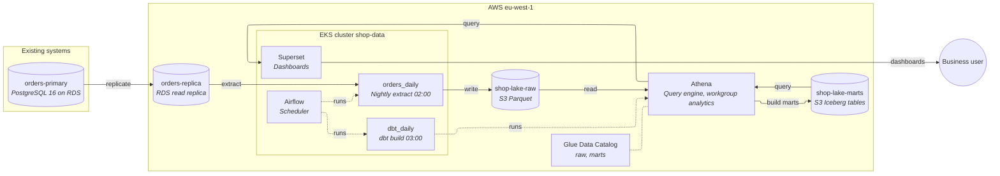

# Current platform

The shop's analytics platform copies the `orders` service database once a night into a data lake on S3, builds reporting tables from it with dbt, and serves dashboards from those tables with Superset. Everything a dashboard shows is therefore up to a day old.

## Architecture

## Components

| Component | What it does | Tool | Source |
|---|---|---|---|
| orders-primary | The orders service database | PostgreSQL 16 on RDS | found in repo (README.md, terraform/main.tf) |
| orders-replica | Read replica the extract reads from (db.r6g.large) | RDS read replica | found in repo (terraform/main.tf) |
| orders_daily | Nightly 02:00 copy of orders changed in the previous day (`updated_at` window) to S3 Parquet | Airflow DAG, SqlToS3Operator | found in repo (dags/orders_daily.py) |
| shop-lake-raw | Raw order extracts, one file per day | S3, Parquet | found in repo (terraform/main.tf) |
| dbt_daily | 03:00 `dbt build` after the extract | Airflow DAG, dbt on Athena | found in repo (dags/dbt_daily.py) |
| stg_orders | One row per order, latest version from the extracts (view) | dbt | found in repo (dbt/models/staging) |
| daily_revenue | Orders and revenue by order date and status (Iceberg table) | dbt | found in repo (dbt/models/marts) |
| Athena | Query engine, workgroup `analytics` | Amazon Athena | found in repo (terraform/main.tf) |
| Glue catalog | Databases `raw` and `marts` | AWS Glue | found in repo (terraform/main.tf) |
| Airflow | Scheduler, KubernetesExecutor, DAGs synced from git | Airflow on EKS 1.33 | found in repo (k8s/values-airflow.yaml) |
| Superset | Dashboards, queries Athena | Superset on EKS | found in repo (k8s/values-superset.yaml) |

## Unknown

- Number of dashboard users and how often they refresh.
- Who operates the platform, and the budget for managed services.
- Whether the orders table holds large text/jsonb columns, and which columns hold personal data.
- Network path between the EKS cluster and the replica beyond what `orders_db_replica` implies.
- Whether `orders` rows are ever hard-deleted.
- Which dashboards read `daily_revenue`, and whether anything else reads `raw.orders`.
