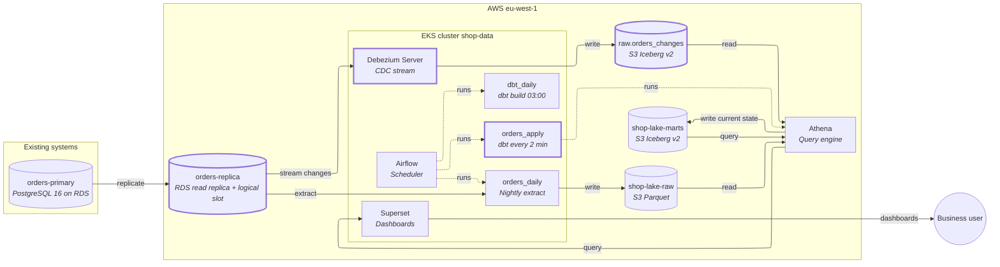
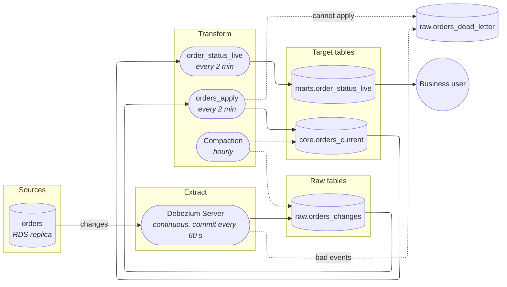

# Order status on the operations dashboard within 5 minutes

## Decision

Stream changes to the `orders` table out of the database's change log (change data capture, CDC) into the lake, keep a current-state orders table up to date every 2 minutes, and point a new live order-status table and dashboard at it. The nightly extract and `daily_revenue` stay as they are until the new path has run in parallel and matched. Nothing is added for other tables, other dashboards, or a separate serving database.

This assumes "within 5 minutes" means 95% of status changes are visible on the dashboard within 5 minutes of being committed in the orders database, and that the dashboard has a handful of viewers (see Questions and assumptions).

## Architecture

Marked components are new or changed; everything else stays as is.

| Component | What it does | Tool |
|---|---|---|
| orders-replica (changed) | Also hosts the logical replication slot (the server-side bookmark the change stream reads from); needs logical replication switched on for primary and replica | RDS PostgreSQL 16 |
| Debezium Server (new) | Reads the change log and writes each change as a row. One small pod, no Kafka | Debezium 3.x, on the existing EKS cluster |
| `raw.orders_changes` (new) | Append-only log of every order change with its log position (LSN) and operation type | Iceberg v2 table on S3, in Glue |
| `raw.orders_dead_letter` (new) | Events that cannot be applied, with payload, error and LSN | Iceberg v2 table |
| `orders_apply` (new) | Every 2 minutes merges new changes into the current-state table, keeping only a newer LSN | Airflow DAG running an incremental dbt model on Athena |
| `core.orders_current` (new) | One row per order, latest state, deletes kept as tombstones (a marker row instead of removal) | dbt incremental model, Iceberg v2 |
| `marts.order_status_live` (new) | Orders per status, plus age of oldest order in each open status | dbt model, Iceberg v2 |
| Table maintenance (new) | Compacts small files and expires old snapshots on the change log and current-state tables | Athena `OPTIMIZE` / `VACUUM` from an hourly Airflow task |
| `stg_orders` (changed later) | After parallel running, reads `core.orders_current` instead of the nightly extract | dbt |
| Superset dashboard (changed) | New operations dashboard on `order_status_live`, auto-refresh every minute, result caching off for it | Superset |

## Pipeline

Time budget for one status change, to land inside 5 minutes: change committed → Debezium file commit (up to 1 min) → next `orders_apply` run (up to 2 min wait plus about 1 min run) → dashboard refresh (up to 1 min) ≈ 4–5 min worst case. The budget is tight, which is why the verification list below includes measuring it.

## Build steps

1. Enable logical replication on `orders-primary` and `orders-replica` and create the slot, publication and a heartbeat on the replica path — delivers: the database is ready to be read continuously, with no change to the app and no change to the nightly extract.
2. Deploy Debezium Server on EKS writing to `raw.orders_changes`, with the initial snapshot of `orders`, WAL cap and slot-lag alert, and the dead-letter table — delivers: every order change lands in the lake within about a minute, and someone is alerted if it stops.
3. Build `core.orders_current` and the `orders_apply` DAG — delivers: analysts can query orders as they are now, not as of last night.
4. Build `marts.order_status_live` and the Superset operations dashboard — delivers: product sees order status changes within 5 minutes, and a freshness tile shows the age of the newest change.
5. Add compaction and snapshot expiry, and a nightly reconciliation of order counts and statuses against the old extract — delivers: query times and cost stay flat, and drift is detected.
6. After two weeks of matching reconciliation, repoint `stg_orders` at `core.orders_current` and retire the nightly extract — delivers: every existing dashboard also becomes near-real-time, and one pipeline remains.

## Why

### Verification

Verify before building:

- **Slot on the replica.** RDS PostgreSQL 16.1+ supports logical decoding on a read replica when `rds.logical_replication` is on for both servers. Confirm the instance's exact version is 16.1 or later.
- **Incremental snapshots from a replica.** Backfills use Debezium's incremental snapshot, which is driven by a signal table. A replica is read-only, so the signal table lives on the primary and replicates down; confirm that path works, or the fallback is a one-off bulk load into the same table guarded by LSN.
- **Debezium Server writing to Iceberg through Glue.** Confirm the Iceberg sink supports the Glue catalog and a 60 s commit interval at current volume.
- **Athena on Iceberg v2 with 2-minute merges.** Measure merge time and file counts for a day of real traffic; the 5-minute budget fails if a merge takes more than about 90 seconds.
- **Network path** from EKS to the replica.
- **Table-format version.** Iceberg v2 is used throughout: Athena cannot read v3 tables, and Athena is the only engine here.

### Source inventory

| Source | Ingestion method | Delete capture | Failure handling |
|---|---|---|---|
| `orders` (PostgreSQL 16, RDS) | CDC from a slot on the read replica. Chosen over a faster poll on `updated_at` because a poll every minute against the replica adds query load every minute, misses rows changed inside long-running transactions, and cannot see hard deletes. | The change log carries deletes; they are kept as tombstones in `core.orders_current`, so a late or redriven update cannot resurrect the row. | Transient failures retry with backoff. Poison events go to `raw.orders_dead_letter` with payload, error and LSN, with an alert on growth and the data platform owner named as the person who clears it. Redrive is guarded by LSN, never by `updated_at`, which ties and drifts. |

Risks of the CDC path and how each is handled:

- **WAL cap plus slot-lag alert.** An uncapped slot can fill the primary's disk; a capped one is lost when it falls behind and forces a re-snapshot. Set a cap and alert on lag well before it.
- **Heartbeat on quiet tables.** A quiet table stops the slot advancing and pins log files; with the slot on the replica, the heartbeat is written on the primary.
- **`hot_standby_feedback`.** Required for a slot on a replica; it pushes vacuum delay and table bloat onto the primary. Watch bloat on `orders` after switching it on.
- **Replica replaced or rebuilt.** The slot survives promotion but not a rebuild; a rebuild means a new slot and an incremental snapshot, so the replica is no longer treated as disposable.
- **Unchanged large columns.** Large text/jsonb values that did not change arrive as a placeholder; the merge keeps the stored value instead of overwriting it. (Whether `orders` has such columns is an open question.)
- **Backfill beside the live stream.** Incremental snapshot rows pass through the same LSN guard, never a separate bulk load over newer rows.
- **Transaction boundaries.** Only `orders` is captured, so no cross-table consistency is needed now; capturing order items later needs it.

### Serving and model design

- **Aggregates stay in Athena.** The dashboard reads a small pre-aggregated table (`order_status_live`), refreshed every 2 minutes, with a handful of viewers; a serving database for point lookups is not warranted. If viewers grow to dozens refreshing every minute, Athena query cost and concurrency become the limit and a small Postgres serving table replaces it.
- **Current state, not history.** `core.orders_current` holds the latest status per order; the full history of status changes is in `raw.orders_changes` for anyone who needs time in status.
- **Late and out-of-order events** are handled by the LSN guard in the merge, not by a reprocessing window.
- **Each load becomes visible whole.** Iceberg commits are atomic, so the dashboard never reads a half-applied merge.
- **Existing marts.** `daily_revenue` groups by status; once repointed, it will reflect status changes as they happen rather than once a day, so a day's revenue by status can change after the day ends. Product should expect that.
- **Rows scanned.** `orders_apply` reads only change-log partitions newer than its last position, so the cost per run does not grow with history.

## Questions and assumptions

1. **Freshness: how do you measure "within 5 minutes", and for which dashboard viewers?** Assumption: 95% of status changes visible within 5 minutes of commit, for the operations dashboard only. 2-minute refresh and auto-refresh follow from that.
2. **How many people watch the dashboard, and how often does it refresh?** Assumption: a handful of viewers, so Athena serves it directly.
3. **Are orders ever hard-deleted, and does `orders` have large text/jsonb columns?** Assumption: deletes are possible and handled; large columns are guarded against either way.

## Open questions

- For the platform owner: who is paged for slot lag and dead-letter growth, and who operates Debezium Server?
- For the platform owner: is `hot_standby_feedback` on the replica acceptable to the orders service team, given the extra bloat risk on the primary?
- For the orders service team: can logical replication be enabled on the primary (a parameter change that needs a restart)?
- For the compliance owner: does `orders` hold personal data (names, addresses) that should be left out of `raw.orders_changes` and the dashboard-facing tables? The design carries every column today and would exclude them in the Debezium column filter.
