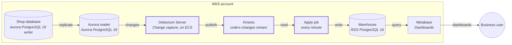

# Orders status within a minute

## Decision

Order changes are captured from the shop database's change log (change data capture, CDC) on the Aurora reader and
applied to the warehouse every minute, so the operations dashboard shows a status within a minute of it changing.
The nightly copy stays for the other tables. Assumes the shop database stays on Aurora PostgreSQL 16.

## Architecture

| Component | What it does | Tool |
|---|---|---|
| Change capture | Reads the reader's change log for `orders` | Debezium Server on ECS |
| Change stream | Carries the changes | Kinesis `orders-changes` |
| Apply job | Lands changes in `raw.orders_changes`, applies them to `core.orders` | Python, scheduled by Airflow |

## Build steps

1. Logical replication on the cluster — delivers: the reader can serve a change log (done).
2. CDC from the Aurora reader into `raw.orders_changes`, with dead letters and a version-guarded apply into
   `core.orders` — delivers: order status in the warehouse within a minute.
3. Dashboard on `core.orders` — delivers: operations see live order status.

## Why

### Source inventory

| Source | Method | Deletes | Failures |
|---|---|---|---|
| `orders` (has a large `details` jsonb column) | CDC from the Aurora reader | change log delete events → tombstones | dead-letter table `raw.orders_dead_letter`; redrive guarded by source position (LSN) |

The slot lives on the reader, keeping the load off the writer. WAL cap plus
slot-lag alert; heartbeat on quiet tables; unchanged large columns arrive as a placeholder.

## Open questions

1. Who owns the dead-letter and slot-lag alerts?
