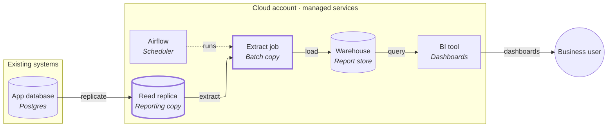
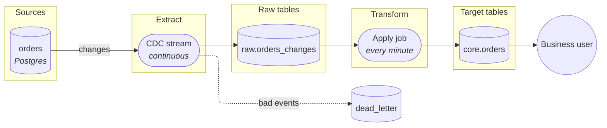

# The document — order and diagrams

Read for every situation except a review. Rules for how every design
document, and `current-platform.md`, is laid out.

## Who reads it

Anyone: a reader with no data-engineering background must follow it, and a
senior engineer or reviewer must still find the reasoning. The big picture
comes first, the reasons last. Define every term in plain words the first
time it appears. Write only the design: never narrate how the document was
produced (no "this run", "non-interactive", "taken as given"), never explain
what you could not do (no web access, no lookup, nobody answered — just
write the list or the assumption), and never mention these files or their
rules.

## Order

Use these headings, in this order; each situation writes only the ones
SKILL.md lists for it, and its Why holds only the sub-sections listed there
(an ingestion design has no tier or layer table).

1. `## Decision` — two or three plain sentences: what gets built, what
   deliberately does not, and the assumption it rests on when one matters
   ("assumes managed services are acceptable").
2. `## Architecture` — the architecture diagram, then a table with one row
   per component: component · what it does · tool. On an existing platform,
   it is the current architecture with new and changed components marked.
3. `## Pipeline` — the pipeline diagram. When a source's whole path is one
   job (source → job → target) that the architecture already shows, a
   sentence replaces the diagram.
4. `## Build steps` — numbered, at design level, and every step ends with
   what it delivers ("1. Read replicas — delivers: reports stop slowing
   production"). A step that delivers nothing a person can see or use
   merges into the step it serves. No code, no commands.
5. `## Why` — the justification, one sub-section per area in scope (the
   area files hold the rules for each):
   - Tier — the simpler tier weighed and why it was rejected.
   - Layer table — default, alternative, and switch condition per layer.
   - Verification — compatibility matrix, or verify-before-building list.
   - Source inventory — per source: ingestion method, delete capture,
     failure handling.
   - Serving and model design — when serving or modeling is in scope.
   - Sensitive data — per column: its decision. For a new platform whose
     sources plainly hold personal data, a short classification is enough
     unless the request asks more.
   - Erasure — only when regulated data is named or erasure is asked.
6. `## Questions and assumptions`, then `## Open questions` — for the owner
   or compliance owner.

## Diagrams

Mermaid flowcharts in fenced `mermaid` blocks. Start every diagram with
this front matter, which lays it out with right-angle connectors:

```
---
config:
  layout: elk
---
```

Never invent: draw only components and hosting that the request, a repo
you read, or `current-platform.md` states. Unknown hosting gets no
boundary; an unknown component is left out, not picked.

**Architecture** — where things run and how they connect.

- `flowchart LR`: existing sources far left, the people who use the data
  far right — one `Business user` node unless the request names roles.
- Every arrow points the way data moves and is labelled with the action
  (extract, write, load, query, dashboards). A tool that reads or queries a
  store gets the arrow from the store to it (`warehouse -- query --> BI`,
  `raw -- read --> Spark`), never the reverse. The only other arrows are
  dotted `runs`: from a scheduler to the job it starts, and from a
  transform tool to the store it runs inside (dbt on a warehouse).
- People only receive arrows, at the far right. Something a person sets off
  (a campaign, an export) is a box, not an arrow back to the left.
- A boundary (`subgraph`) for each place things run: a Kubernetes cluster,
  a cloud account or managed services. The existing-systems boundary holds
  only sources; an existing warehouse or BI tool sits where it is in the
  flow, so every arrow still runs left to right.
- A component whose hosting is not stated sits outside every boundary.
- A box is the tool with its role beneath: `"Airflow<br/><i>Scheduler</i>"`
  — always a named tool (the chosen default when it is a choice). Storage
  is a cylinder `[( )]`, people a circle `(( ))`.
- On an existing platform, mark only new and changed components with
  `classDef new` and `class <ids> new`; components that stay as they are
  are never marked.



**Pipeline** — which job moves which data into which table.

- `flowchart LR`, columns as subgraphs: `Sources · Extract · Raw tables ·
  Transform · Target tables`, then the users.
- Jobs are rounded boxes with how often they run (`(["Poll job<br/><i>hourly</i>"])`);
  tables are cylinders named with their layer (`raw.orders`, `core.orders`).
- Where a source has a dead-letter table (or a quarantine table, for late
  or invalid rows), the pipeline diagram draws it on dotted edges (`-.->`).
  A source that fails the run on a bad record draws none.



## `current-platform.md`

What already exists, recorded once and reused by later requests:

1. `# Current platform` and one paragraph on what it does today.
2. `## Architecture` — the architecture diagram of what exists (nothing
   proposed), under the rules above.
3. `## Components` — table: component · what it does · tool · source, where
   source is `found in repo` (with the file) or `told by you`.
4. `## Unknown` — what neither the repo nor the user said.
